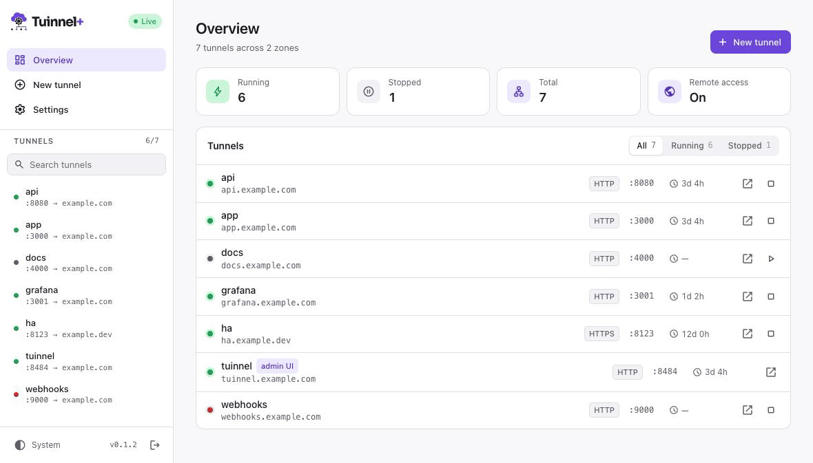

# tuinnel-plus

Manage [Cloudflare Tunnels](https://developers.cloudflare.com/cloudflare-one/connections/connect-networks/) from a terminal dashboard, a web UI, or the command line. Expose local servers on subdomains of your own domains — add, edit, delete, start and stop tunnels, watch their logs and metrics, and keep them running in the background.

Based on [tuinnel](https://github.com/NickDunas/tuinnel) by Nick Dunas.



```
$ tuinnel-plus

┌─────────────────┬──────────────────────────────────────┐
│  TUNNELS        │  [1:Details] [2:Logs] [3:Metrics]    │
│  ◉ app :3000    │                                      │
│  ◌ api :8080    │  Status: ◉ Connected  Uptime: 00:12  │
│                 │  Public: https://app.mysite.com      │
└─────────────────┴──────────────────────────────────────┘
 a Add  d Delete  e Edit  s Start/Stop  r Restart  ? Help
```

## Features

- **Background service** — `tuinnel-plus serve` owns the tunnels. The terminal dashboard, the CLI and the web UI are all clients of it, so closing any of them leaves your tunnels running
- **Web UI** — Live tunnel list, details, logs and metrics, add/edit/delete/start/stop, light and dark theme, and an accent colour of your choice. Password-protected, bound to `127.0.0.1:8484` by default
- **Remote access (optional)** — Publish the web UI on a subdomain through its own tunnel, behind your password
- **Starts at login (macOS)** — `tuinnel-plus service install` registers a launchd agent
- **Terminal dashboard** — Sidebar with fuzzy search, log filtering and scroll-back, command palette (`Ctrl+K`)
- **Custom domains** — Map local ports to subdomains on domains you own (`app.mysite.com`, `api.mysite.com`)
- **Quick tunnels** — Zero-config tunnels via `trycloudflare.com` (no account needed)
- **Remembers what was running** — Tunnels that were running come back after a restart or reboot
- **Smart defaults** — Suggests subdomain names from `package.json` and well-known ports (4200 = "angular", 5173 = "vite", …)
- **Managed binary** — Downloads and manages the `cloudflared` binary for you
- **Clean deletes** — Removing a tunnel also removes its DNS record and Cloudflare tunnel; `purge` finds leftovers
- **Diagnostics** — `tuinnel-plus doctor` checks your token, permissions, binary and network

## Requirements

- **Node.js 20+**
- **macOS or Linux** (darwin-arm64, darwin-x64, linux-arm64, linux-x64). Windows is not supported
- A **Cloudflare account** with at least one domain (for named tunnels; quick tunnels work without one)

## Installation

```bash
npm install -g tuinnel-plus
```

Or from source (requires [Bun](https://bun.sh) to build):

```bash
git clone https://github.com/mrpap/tuinnel-plus.git
cd tuinnel-plus
bun install
bun run build
npm install -g .
```

## Quick start

```bash
# Open the terminal dashboard (the first run shows a setup wizard)
tuinnel-plus

# Start a tunnel for port 3000 (adds it if it's new)
tuinnel-plus 3000
```

The first command that needs the background service starts it for you. Open the web UI at <http://127.0.0.1:8484>; on the first visit you choose a password.

### Zero-config (no account needed)

```bash
tuinnel-plus up 3000 --quick
# => https://random-words.trycloudflare.com <- :3000
```

Quick tunnels run in the foreground and stop with `Ctrl+C`.

### Run it at login (macOS)

```bash
tuinnel-plus service install     # start now and at every login
tuinnel-plus service status
tuinnel-plus service uninstall
```

On Linux, run `tuinnel-plus serve` under your own process manager. A systemd user unit, for example:

```ini
# ~/.config/systemd/user/tuinnel-plus.service
[Unit]
Description=tuinnel-plus
After=network-online.target

[Service]
ExecStart=/usr/bin/env tuinnel-plus serve
Restart=always

[Install]
WantedBy=default.target
```

```bash
systemctl --user enable --now tuinnel-plus
```

## The background service and web UI

`tuinnel-plus serve` runs the API, the web UI and every tunnel in one process. It listens on `127.0.0.1:8484` (`--port` and `--host` change that). There is one service per state directory.

- **Terminal dashboard and CLI** find the service through `~/.tuinnel/daemon.json` and authenticate with a random token stored there (readable only by you). Quitting the dashboard disconnects; tunnels keep running.
- **Web UI** uses a password. Set or change it in the web UI, or with `tuinnel-plus password set`.
- **Logs** go to `~/.tuinnel/logs/daemon.log`.

### Remote access to the web UI

```bash
tuinnel-plus expose --subdomain admin               # uses your default zone
tuinnel-plus expose --subdomain admin --zone mysite.com
tuinnel-plus expose --off
```

This creates a tunnel to the web UI itself, so you can reach it at `https://admin.mysite.com` from anywhere. It can also be turned on from Settings in the web UI.

### Security model

- The service only listens on the loopback interface unless you pass `--host`.
- Browser sessions need the password. Login attempts are rate-limited per client IP, and the session cookie is `HttpOnly`, `SameSite=Lax`, and `Secure` when reached through Cloudflare.
- The first password can only be set from this machine, never through the remote-access tunnel.
- State-changing requests from the browser must be same-origin JSON, so other websites can't act on your behalf.
- The config file, `daemon.json` and the launchd agent file are written with `0600` permissions.
- For stronger protection of the remote web UI, put [Cloudflare Access](https://developers.cloudflare.com/cloudflare-one/policies/access/) in front of its hostname.

## Creating a Cloudflare API token

tuinnel-plus needs a scoped API token (not the Global API Key).

1. Go to [dash.cloudflare.com/profile/api-tokens](https://dash.cloudflare.com/profile/api-tokens) and click **Create Token**, then **Create Custom Token**.
2. Add these permissions:

   | Permission | Access | Why it's needed |
   |---|---|---|
   | **Zone** > **Zone** | Read | List your domains and discover your account |
   | **Zone** > **DNS** | Edit | Create and delete the CNAME records that point subdomains at your tunnels |
   | **Account** > **Cloudflare Tunnel** | Edit | Create, configure and delete tunnels |

3. Under **Zone Resources**, choose all zones or only the domains you want to use. Under **Account Resources**, pick the account that owns them.
4. Optionally restrict the token to your IP address and set an expiry date.
5. Create the token and copy it — Cloudflare shows it only once.

Then run `tuinnel-plus` (the setup wizard asks for it) or `tuinnel-plus init`. The token is validated, you pick a default zone, and everything is saved to `~/.tuinnel/config.json`.

You can also provide the token through the environment instead; it takes priority over the config file:

```bash
export CLOUDFLARE_API_TOKEN="your-token-here"   # or TUINNEL_API_TOKEN
```

Check the setup with `tuinnel-plus doctor`. It verifies the config file, the token and its permissions, the `cloudflared` binary and network access to Cloudflare.

### Common token issues

| Symptom | Cause | Fix |
|---|---|---|
| `Authentication failed` | Token is invalid, revoked or expired | Create a new token |
| `Insufficient permissions` | A required permission is missing | Edit the token and add Zone:Read, DNS:Edit or Cloudflare Tunnel:Edit |
| `No zones found` | The token has no zone access | Add your domain to the token's Zone Resources |
| `This looks like a Global API Key` | You pasted the 37-character Global API Key | Create an **API Token** instead |

## Commands

| Command | Description |
|---|---|
| `tuinnel-plus` | Open the terminal dashboard |
| `tuinnel-plus <port>` | Same as `up <port>` |
| `tuinnel-plus init` | Set up your API token and default zone |
| `tuinnel-plus up [ports...]` | Start tunnels for ports (adding new ones) and open the dashboard |
| `tuinnel-plus up <port> -s <name> -z <domain>` | Choose the subdomain and zone for a new tunnel |
| `tuinnel-plus up <port> --quick` | Start a temporary quick tunnel (no account needed) |
| `tuinnel-plus up <port> --no-tui` | Start tunnels and return to the prompt |
| `tuinnel-plus down [names...]` | Stop tunnels |
| `tuinnel-plus down --all` | Stop all running tunnels |
| `tuinnel-plus down <name> --clean` | Stop a tunnel and delete it from Cloudflare and the config |
| `tuinnel-plus add <port>` | Add a tunnel without starting it |
| `tuinnel-plus remove <name>` | Delete a tunnel: stop it and remove it from Cloudflare and the config |
| `tuinnel-plus list` | List configured tunnels |
| `tuinnel-plus status` | Show running tunnels and their state |
| `tuinnel-plus zones` | List your Cloudflare zones |
| `tuinnel-plus doctor` | Run diagnostics |
| `tuinnel-plus purge` | Find and delete leftover Cloudflare tunnels that have no local config entry |
| `tuinnel-plus serve` | Run the background service in the foreground |
| `tuinnel-plus service install\|uninstall\|status` | Manage the macOS login item |
| `tuinnel-plus password set` | Set or change the web UI password |
| `tuinnel-plus expose` | Publish the web UI through Cloudflare (`--off` to stop) |

Aliases: `start` = `up`, `stop` = `down`, `rm` = `remove`, `ls` = `list`.

Flags: `--verbose` (global), `--json` (`list`, `status`, `zones`), `-v`/`--version`, `--help`.

`purge` never deletes a tunnel that has live connections, since that tunnel is running somewhere else (another machine using the same Cloudflare account, for example).

## Terminal dashboard keys

| Key | Action |
|---|---|
| `q` | Quit (tunnels keep running) |
| `a` | Add a tunnel |
| `Ctrl+K` | Command palette |
| `?` | Help |
| `Tab` | Switch focus between the sidebar and the main panel |
| `1` `2` `3` | Details / Logs / Metrics |
| `↑` `↓` / `k` `j` | Move through the tunnel list |
| `/` | Search tunnels (sidebar) or filter logs (Logs tab) |
| `e` `d` `s` `r` | Edit / delete / start-stop / restart the selected tunnel |
| `c` / `o` | Copy / open the public URL |

In the Logs tab, `↑` `↓` `PgUp` `PgDn` scroll back and pause the live tail; `Esc` resumes it.

## How it works

1. The **Cloudflare API** creates the tunnel, its ingress rule and the DNS CNAME record.
2. A **`cloudflared`** connector process per tunnel keeps the connection to Cloudflare's edge.
3. **Metrics** are scraped from each connector's local Prometheus endpoint.

Tunnels are named with a `tuinnel-` prefix on Cloudflare to avoid collisions with other tools.

## Files

Everything lives in `~/.tuinnel/` (set `TUINNEL_HOME` to use another directory, e.g. to run a second, fully separate instance):

| Path | Contents |
|---|---|
| `config.json` | API token, default zone, tunnels, web UI settings |
| `daemon.json` | Address and local token of the running service |
| `logs/daemon.log` | Service log |
| `bin/cloudflared` | Managed `cloudflared` binary |

```jsonc
{
  "version": 1,
  "apiToken": "your-api-token",
  "defaultZone": "mysite.com",
  "tunnels": {
    "app": {
      "port": 3000,
      "subdomain": "app",
      "zone": "mysite.com",
      "protocol": "http",
      "lastState": "running",
      "tunnelId": "xxxxxxxx-xxxx-xxxx-xxxx-xxxxxxxxxxxx"
    }
  }
}
```

`lastState` records whether you left a tunnel running; the service starts those tunnels again when it starts.

## Releasing

1. On `dev`, bump `version` in `package.json` and add an entry to `CHANGELOG.md`.
2. Merge `dev` into `main` through a pull request.
3. Tag the merge commit on `main` and push the tag: `git tag v0.1.1 && git push origin v0.1.1`.
4. Approve the staged version on npmjs.com (Staged Packages) with two-factor authentication.

The release workflow tests and builds the tagged commit, stages it on npm with provenance, and creates the GitHub release. It refuses tags that aren't on `main` or don't match `package.json`. Nothing reaches npm users until the staged version is approved.

## Development

```bash
bun install          # dependencies
bun run build        # build to dist/
bun run dev          # build in watch mode
bunx tsc --noEmit    # type-check
bun test             # run the tests
```

Tests never touch your real `~/.tuinnel`: a preload points `TUINNEL_HOME` at a temporary directory, and the code refuses to use the real one under the test runner.

## Roadmap

See [ROADMAP.md](ROADMAP.md) for what's planned next.

## License

MIT — see [LICENSE](LICENSE).
